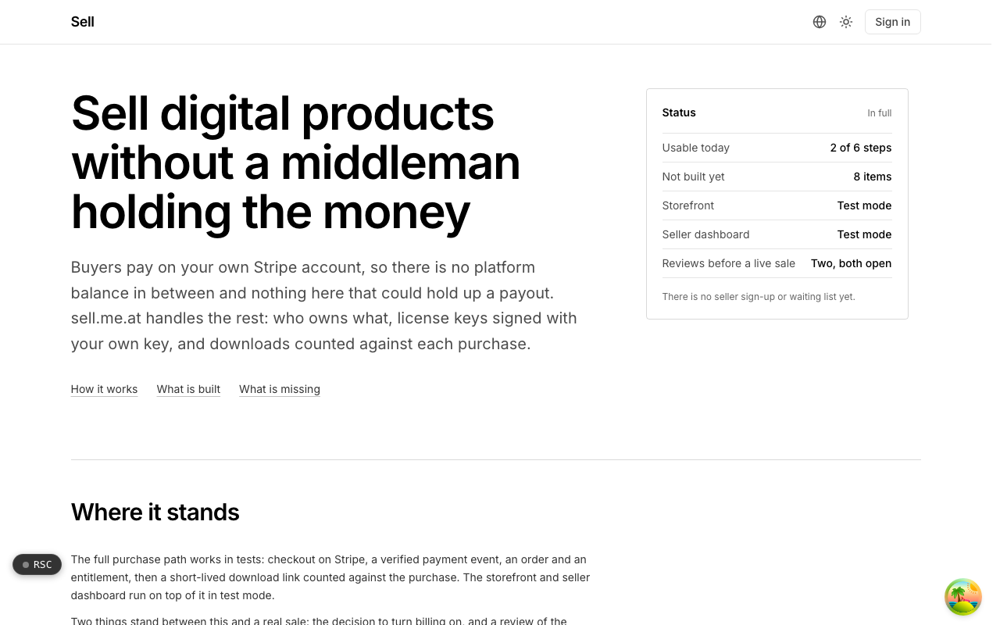

  <picture>
    <source media="(prefers-color-scheme: dark)" srcset=".github/assets/hero-dark.png">
    
  </picture>

# sell.me.at

Sell digital products without a middleman holding the money.

sell.me.at is a hosted storefront for digital products: downloads, license keys and content bundles. Buyers pay on the seller's own Stripe account, so there is no platform balance in between and nothing here that could hold up a payout. It is a platform, not a merchant of record: your sales, your tax, your payouts. The storefront and seller dashboard currently run in test mode only; live checkout stays switched off in code until billing go-live and a review of the payment code are complete.

## Features

- **You are the seller of record**: checkout hands the buyer to a Stripe-hosted payment page on the seller's connected account. sell.me.at never sets the charge amount and has no tax field.
- **Your own license signing key**: each seller gets an Ed25519 keypair, and license keys are signed with it (never a shared platform key). The private key is stored encrypted.
- **Storefront and seller dashboard**: a public storefront per seller, plus a dashboard for drafts, multipart file uploads, prices, publishing and archiving (test mode).
- **Counted downloads**: each purchase carries a download allowance, links are short-lived, and every download request is logged, including refusals.
- **One payment, one order, one entitlement**: verified Stripe webhooks create orders and entitlements idempotently; refunds and disputes revoke access.
- **Promo codes applied by Stripe**: codes are validated at checkout and the discount is applied through a coupon on the seller's own account.
- **Leaving does not strand customers**: closing a storefront suspends it, so buyers keep their purchases and the public key that verifies their licenses.
- **Fails safe by default**: without Stripe keys the app runs against a mock payment provider and charges nobody.

## Built with

- Next.js 16 (App Router), React 19, TypeScript
- Tailwind CSS 4
- Drizzle ORM + Postgres
- Better Auth
- oRPC + TanStack Query
- Stripe (hosted checkout on connected accounts, verified webhooks)
- Upstash rate limiting

## Part of the me.at family

sell.me.at is one of the [`*.me.at`](https://me.at) apps by Trevor McDougald. They share one design system, account, and app shell. Development happens in a private monorepo; this repository is the project's public-facing home.

## License

See [LICENSE](LICENSE).
