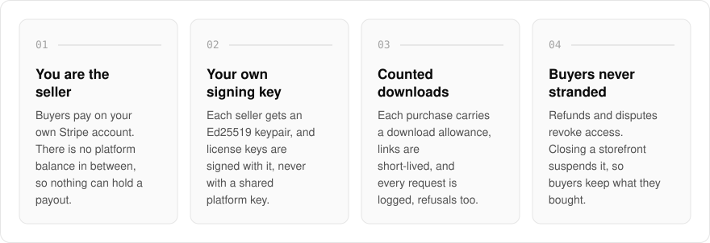
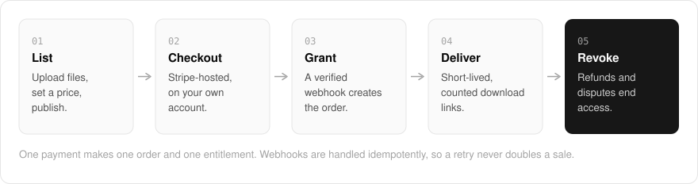

  <picture>
    <source media="(prefers-color-scheme: dark)" srcset=".github/assets/hero-dark.png">
    
  </picture>

<h1 align="center">sell.me.at</h1>

<strong>Sell digital products without a middleman holding the money.</strong>

  
  
  

  <a href="#features">Features</a> ·
  <a href="#how-it-works">How it works</a> ·
  <a href="#built-with">Built with</a>

Most storefronts for digital goods collect the money first and pay you out later, on their schedule. I built sell.me.at so buyers pay on your own Stripe account: there is no platform balance in between and nothing here that could hold up a payout. It is a hosted storefront for downloads, license keys and content bundles, and it is a platform, not a merchant of record. Your sales, your tax, your payouts.

> **Status:** in development. The storefront and seller dashboard run in test mode only. Live checkout stays switched off in code until billing go-live and a review of the payment code are complete.

  <picture>
    <source media="(prefers-color-scheme: dark)" srcset=".github/assets/overview-dark.svg">
    
  </picture>

## Why sell.me.at

| The usual digital storefront | sell.me.at |
| --- | --- |
| Holds your money in a platform balance | Buyers pay on your own Stripe account |
| License keys signed with the platform's key | Signed with your own Ed25519 key |
| Download links that work forever | Short-lived links, a download allowance, every request logged |
| Closing the shop strands your buyers | A closed storefront is suspended, and buyers keep their purchases |

## Features

- **You are the seller of record**: checkout hands the buyer to a Stripe-hosted payment page on the seller's connected account. sell.me.at never sets the charge amount and has no tax field.
- **Your own license signing key**: each seller gets an Ed25519 keypair, and license keys are signed with it, never with a shared platform key. The private key is stored encrypted.
- **Storefront and seller dashboard**: a public storefront per seller, plus a dashboard for drafts, multipart file uploads, prices, publishing and archiving (test mode).
- **Counted downloads**: each purchase carries a download allowance, links are short-lived, and every download request is logged, including refusals.
- **One payment, one order, one entitlement**: verified Stripe webhooks create orders and entitlements idempotently, and refunds and disputes revoke access.
- **Promo codes applied by Stripe**: codes are validated at checkout and the discount is applied through a coupon on the seller's own account.
- **Leaving does not strand customers**: closing a storefront suspends it, so buyers keep their purchases and the public key that verifies their licenses.
- **Fails safe by default**: without Stripe keys the app runs against a mock payment provider and charges nobody.

## How it works

  <picture>
    <source media="(prefers-color-scheme: dark)" srcset=".github/assets/flow-dark.svg">
    
  </picture>

A seller uploads files, sets a price and publishes. Checkout happens on a Stripe-hosted page on the seller's own account, and a verified webhook turns one payment into one order and one entitlement, idempotently. Downloads go out through short-lived, counted links, and a refund or dispute revokes access.

## Built with

  
  
  
  
  
  

- Next.js 16 (App Router), React 19, TypeScript
- Tailwind CSS 4
- Drizzle ORM + Postgres
- Better Auth
- oRPC + TanStack Query
- Stripe (hosted checkout on connected accounts, verified webhooks)
- Upstash rate limiting

## Part of the me.at family

sell.me.at is one of my [`*.me.at`](https://me.at) apps. They share one design system, one account, and one app shell. Development happens in a private monorepo; this repository is the project's public-facing home.

## License

Source-available. See [LICENSE](LICENSE).
